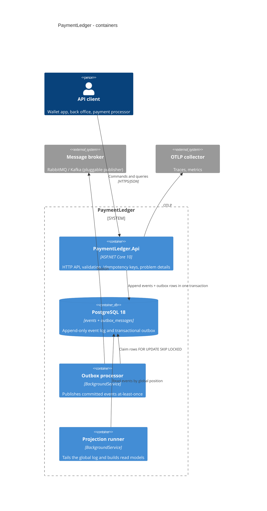
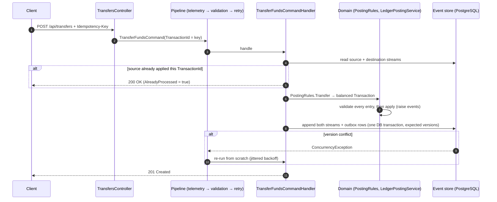

# PaymentLedger

[](https://github.com/blayner/PaymentLedger/actions/workflows/ci.yml)

A payment ledger built on **Event Sourcing**, **CQRS** and **double-entry bookkeeping**, with a
transactional outbox for reliable integration events. .NET 10 / C# 14, PostgreSQL 18.

The goal is a small codebase where the hard parts of a money-moving system are explicit and
tested: an unbalanced posting cannot be constructed, a retried request cannot post twice, and
an integration event cannot be lost when the process crashes after a commit.

## Contents

- [Architecture](#architecture)
- [Domain model](#domain-model)
- [Write path](#write-path-a-transfer)
- [Read path](#read-path)
- [Reliability guarantees](#reliability-guarantees)
- [API](#api)
- [Running locally](#running-locally)
- [Testing](#testing)
- [Observability](#observability)
- [Architecture Decision Records](#architecture-decision-records)
- [Known limitations](#known-limitations)

## Architecture



Clean Architecture with dependencies pointing inwards:

```
src/
  PaymentLedger.Domain/          Aggregates, value objects, domain events, posting rules. No dependencies.
  PaymentLedger.Application/     Commands, queries, handlers, pipeline behaviours, projections.
  PaymentLedger.Infrastructure/  Event stores (in-memory, PostgreSQL), outbox, read-model stores, health checks.
  PaymentLedger.Api/             Controllers, error mapping, observability wiring.
tests/
  PaymentLedger.Domain.Tests/        Pure domain tests (no I/O).
  PaymentLedger.Application.Tests/   Handlers against the in-memory event store.
  PaymentLedger.Integration.Tests/   Real API + PostgreSQL via Testcontainers.
docs/adr/                         Architecture Decision Records.
```

## Domain model

| Concept | Responsibility |
| --- | --- |
| `Money` | Amount + ISO 4217 currency at a fixed scale of 2. Rejects extra precision instead of rounding. |
| `Account` | Event-sourced aggregate. Customer wallets are **liabilities**; settlement accounts are **assets**. |
| `LedgerEntry` | One side of a posting: account, `Debit`/`Credit`, positive amount. |
| `Transaction` | A journal entry. `Transaction.Create` refuses to build one unless debits equal credits, all entries share a currency and no account appears twice. |
| `PostingRules` | Chart-of-accounts rules per operation (deposit, withdrawal, transfer). |
| `LedgerPostingService` | Validates every entry against its account, then applies them all. All or nothing. |

Postings per operation:

| Operation | Debit | Credit |
| --- | --- | --- |
| Deposit | Settlement (asset, cash in) | Customer (liability, we owe more) |
| Withdrawal | Customer (we owe less) | Settlement (cash out) |
| Transfer | Source customer | Destination customer |

Because every movement is a balanced transaction, **assets always equal liabilities**: the
settlement account balance equals the sum of all customer balances. The domain tests assert this.

## Write path (a transfer)



## Read path

- **Projections** tail the global event log (`global_position`) and build two read models: account
  summaries and the general ledger. Reading the ordered log, rather than reacting to in-process
  notifications, means projections see events in commit order and a fresh process rebuilds its
  read models by replaying from position zero.
- Writes made through an instance are projected **before the command returns** (read-your-writes);
  a background poller catches writes from other instances.
- `GET /api/accounts/{id}/balance` deliberately bypasses the read model and folds the event stream:
  a balance shown right before a withdrawal must not be stale.
- `GET /api/ledger/trial-balance` sums debits and credits per currency. A non-zero difference means
  something bypassed the double-entry engine, and is what reconciliation should alert on.

## Reliability guarantees

| Concern | Mechanism |
| --- | --- |
| Duplicate requests | `Idempotency-Key` header becomes the transaction id. Aggregates remember applied transaction ids; replays return `200` with `alreadyProcessed: true`. |
| Lost updates | Optimistic concurrency on every stream (`expected version`), plus a unique `(stream_id, version)` constraint. |
| Partial transfers | Multi-stream append in one database transaction: both accounts change or neither does. |
| Hot settlement stream | `ConcurrencyRetryBehavior` re-runs marked commands on conflict, with jittered backoff. |
| Lost integration events | Transactional outbox written with the events; at-least-once delivery, event id as dedup key. |
| Out-of-order projection | Appends take a transaction-scoped advisory lock so `global_position` is committed in order ([ADR-0004](docs/adr/0004-serialised-appends-and-atomic-multi-stream-writes.md)). |

## API

| Method | Route | Notes |
| --- | --- | --- |
| `POST` | `/api/accounts` | Open a customer account. |
| `GET` | `/api/accounts` | Paged list (`page`, `pageSize`, `includeSystem`). |
| `GET` | `/api/accounts/{id}` | Account summary (read model). |
| `GET` | `/api/accounts/{id}/balance` | Strongly consistent balance (event stream). |
| `POST` | `/api/accounts/{id}/deposits` | Requires `Idempotency-Key`. |
| `POST` | `/api/accounts/{id}/withdrawals` | Requires `Idempotency-Key`. |
| `POST` | `/api/accounts/{id}/freeze` · `/unfreeze` · `/close` | Lifecycle. |
| `POST` | `/api/transfers` | Requires `Idempotency-Key`. |
| `GET` | `/api/ledger/accounts/{id}/entries` | General ledger for one account, newest first. |
| `GET` | `/api/ledger/transactions/{id}` | Both sides of a transaction. |
| `GET` | `/api/ledger/trial-balance` | Debits vs credits per currency. |
| `GET` | `/health/live` · `/health/ready` | Liveness and readiness. |

Errors are RFC 7807 problem details. Business-rule violations return `422` with a stable `code`
(for example `account.insufficient_funds`), so clients branch on the code rather than the message.
In Development the OpenAPI document is served at `/openapi/v1.json`. `requests.http` walks through
the main flows.

## Running locally

Requirements: .NET 10 SDK; Docker for the PostgreSQL setup and integration tests.

```bash
# Full stack: API on :5080, PostgreSQL, and the Aspire dashboard on :18888 for traces and metrics
docker compose up --build

# API only, with the in-memory event store (no Docker needed)
dotnet run --project src/PaymentLedger.Api
```

Configuration (`appsettings.json` or environment variables):

| Key | Default | Meaning |
| --- | --- | --- |
| `Persistence:Provider` | `InMemory` | `InMemory` or `Postgres`. |
| `ConnectionStrings:Ledger` | (empty) | Required for `Postgres`. |
| `Outbox:BatchSize` / `MaxAttempts` | `100` / `10` | Messages past `MaxAttempts` are dead-lettered. |
| `Outbox:MaxHealthyLag` | `00:01:00` | Readiness reports `Degraded` above this lag. |
| `OTEL_EXPORTER_OTLP_ENDPOINT` | (unset) | Enables OTLP export when set. |

## Testing

```bash
dotnet test tests/PaymentLedger.Domain.Tests
dotnet test tests/PaymentLedger.Application.Tests
dotnet test tests/PaymentLedger.Integration.Tests   # starts postgres:18 with Testcontainers
```

- **Domain**: money arithmetic, balancing rules, all-or-nothing postings, assets = liabilities.
- **Application**: handlers against the in-memory store: idempotent replays, no partial writes on
  failure, projections and trial balance, retry and validation behaviours.
- **Integration**: real HTTP + PostgreSQL: idempotency keys, problem details, concurrent deposits on
  the hot settlement stream, multi-stream atomicity, paging through the global log, and read-model
  rebuild after a restart.

xunit.v3 with Shouldly. CI runs the unit suites, the integration suite and a Docker build on every push.

## Observability

- **Traces**: one span per command or query (`TelemetryBehavior`), ASP.NET Core and Npgsql spans.
- **Metrics** (meter `PaymentLedger`): `ledger.transactions.posted`, `ledger.concurrency.retries`,
  `ledger.request.duration`, `ledger.outbox.published`, `ledger.outbox.failed`.
- **Logs**: Serilog, compact JSON in production, with a `CorrelationId` from `X-Correlation-Id`
  (or the trace id) on every line of a request.
- **Health**: `/health/live` (process) and `/health/ready` (PostgreSQL reachable, outbox lag and
  dead letters).

No performance figures are published here. To measure throughput on your hardware, run the
compose stack, drive `POST /api/transfers` with a load tool (k6, bombardier, NBomber), and read
`ledger.request.duration` and `ledger.concurrency.retries` in the dashboard. The retry counter
shows how much the per-currency settlement stream is costing ([ADR-0004](docs/adr/0004-serialised-appends-and-atomic-multi-stream-writes.md)).

## Architecture Decision Records

| ADR | Decision |
| --- | --- |
| [0001](docs/adr/0001-event-sourcing-for-accounts.md) | Event sourcing for accounts |
| [0002](docs/adr/0002-cqrs-with-projections-from-the-global-log.md) | CQRS with projections built from the global log |
| [0003](docs/adr/0003-double-entry-enforced-in-the-domain.md) | Double-entry bookkeeping enforced in the domain model |
| [0004](docs/adr/0004-serialised-appends-and-atomic-multi-stream-writes.md) | Serialised appends and atomic multi-stream writes instead of a saga |
| [0005](docs/adr/0005-transactional-outbox.md) | Transactional outbox for integration events |
| [0006](docs/adr/0006-in-house-dispatcher-and-test-libraries.md) | In-house dispatcher (no MediatR) and permissively licensed test libraries |

## Known limitations

- Read models are in-memory per instance and rebuilt on start-up. Fine for this scope; a large log
  would need persisted read models with a stored checkpoint.
- Appends are serialised by one advisory lock. That caps write throughput in exchange for a simple,
  gap-free global order. Sharding the lock by currency, or moving to a log with native ordering,
  is the next step if it becomes the bottleneck.
- The settlement account per currency is a hot stream. Splitting it into several sub-accounts
  (summed for reporting) would spread contention.
- Applied transaction ids live in aggregate state, so very long-lived accounts would benefit from
  snapshots and a bounded idempotency window.
- The default publisher logs messages; a broker adapter (RabbitMQ, Kafka) implements
  `IIntegrationEventPublisher`.
- Single currency per account; FX is out of scope.
